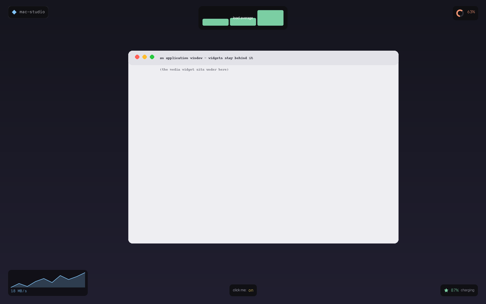
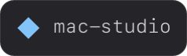

<!--
*** stratum — desktop widget runtime.
***
*** Structure follows the Best-README-Template (shields, centred title block,
*** table of contents, About / Getting Started / Usage / Roadmap / Contributing /
*** License / Contact / Acknowledgements, reference-style links at the bottom).
*** Every number and command in this file was measured or run; see HANDOFF.md.
-->

<!-- PROJECT SHIELDS -->
[![Rust][rust-shield]][rust-url]
[![Platform macOS][platform-shield]][platform-url]
[![Tests][tests-shield]][tests-url]
[![Binary size][binary-shield]][binary-url]

<!-- PROJECT LOGO -->
<br />
<p align="center">
  
  <h3 align="center">stratum</h3>
  <p align="center">
    Desktop widgets drawn from scratch: placed anywhere, on any display, composed
    of text, icons and charts — and driven by whatever can print a line.
    <br />
    <a href="HANDOFF.md"><strong>Read the handoff »</strong></a>
    <br />
    <br />
    <a href="#usage">Usage</a>
    ·
    <a href="#configuration">Configuration</a>
    ·
    <a href="#scripts">Scripts</a>
    ·
    <a href="#roadmap">Roadmap</a>
  </p>
</p>

<!-- TABLE OF CONTENTS -->
<details open="open">
  <summary><h2 style="display: inline-block">Table of Contents</h2></summary>
  <ol>
    <li>
      <a href="#about-the-project">About The Project</a>
      <ul>
        <li><a href="#built-with">Built With</a></li>
        <li><a href="#how-it-works">How It Works</a></li>
      </ul>
    </li>
    <li>
      <a href="#getting-started">Getting Started</a>
      <ul>
        <li><a href="#prerequisites">Prerequisites</a></li>
        <li><a href="#installation">Installation</a></li>
        <li><a href="#first-run">First Run</a></li>
      </ul>
    </li>
    <li><a href="#usage">Usage</a></li>
    <li><a href="#configuration">Configuration</a></li>
    <li><a href="#example-widgets">Example Widgets</a></li>
    <li>
      <a href="#creating-a-widget">Creating a Widget</a>
      <ul>
        <li><a href="#1-where-it-lives">1. Where it lives</a></li>
        <li><a href="#2-where-it-sits">2. Where it sits</a></li>
        <li><a href="#3-what-it-draws">3. What it draws</a></li>
        <li><a href="#4-where-the-numbers-come-from">4. Where the numbers come from</a></li>
        <li><a href="#5-see-it-without-going-live">5. See it without going live</a></li>
        <li><a href="#6-put-it-on-the-desktop">6. Put it on the desktop</a></li>
        <li><a href="#7-make-it-interactive">7. Make it interactive</a></li>
        <li><a href="#8-start-from-one-that-already-works">8. Start from one that already works</a></li>
        <li><a href="#field-reference">Field reference</a></li>
        <li><a href="#when-it-does-not-show-up">When it does not show up</a></li>
        <li><a href="#recipes">Recipes</a></li>
      </ul>
    </li>
    <li><a href="#scripts">Scripts</a></li>
    <li>
      <a href="#testing">Testing</a>
      <ul>
        <li><a href="#continuous-integration">Continuous Integration</a></li>
      </ul>
    </li>
    <li><a href="#resource-profile">Resource Profile</a></li>
    <li><a href="#security">Security</a></li>
    <li><a href="#roadmap">Roadmap</a></li>
    <li><a href="#contributing">Contributing</a></li>
    <li><a href="#license">License</a></li>
    <li><a href="#contact">Contact</a></li>
    <li><a href="#acknowledgements">Acknowledgements</a></li>
  </ol>
</details>

<!-- ABOUT THE PROJECT -->
## About The Project

<p align="center">
  
  
  
  <br>
  <em>Captured from the live layer tree by <code>stratum live --snapshot</code> —
  transparent windows, no background behind them.</em>
</p>

**stratum** puts widgets on your desktop instead of in your menu bar. A widget is
data — a TOML block with an anchor, an optional frame, and an ordered list of
elements. There are exactly three element types, and any widget is a composition
of them:

| atom | forms | notes |
|---|---|---|
| **text** | `static` (a label) or `dynamic` (`{{key}}` from a script) | alignment, per-side padding, `max_chars` ellipsis |
| **icon** | SVG or PNG/bitmap | rasterised at the target size, tintable, cached |
| **graph** | donut, line, bar | donut has a `weight` (1.0 = full ring, 0.5 = semicircle); series tween on change |

Widgets sit at **desktop level** by default: app windows cover them, the way they
cover the wallpaper. Set `always_on_top = true` on the one that must stay visible
while you work. Clicks pass through by default; `click_through = false` plus
`on = ["click"]` makes a widget interactive.

The design is a deliberate port of SketchyBar's drawing model — one offscreen
bitmap per widget, painted from scratch, presented as a `CGImage` on a `CALayer` —
generalised so a widget can live anywhere on any display instead of being pinned
to the bar.

### Inspirations

None of the interesting ideas here are mine. [SketchyBar][sketchybar] by **Felix
Kratz** established the model this project copies: one offscreen bitmap per item,
painted from scratch, handed to the compositor, and driven by scripts that print
`key=value`. The item model, the plugin protocol and the "everything can change at
any time" ergonomics are his design, and they are why a widget bar can feel
scriptable instead of compiled. Go and read that project before this one.

A specific thank-you to [the **Share your plugins** thread][plugins-thread] in
SketchyBar's discussions — this project grew out of that conversation. If you
build something with stratum, that thread is still the best place to see how far
the idea can be pushed.

### Built With

* [Rust](https://www.rust-lang.org/) — edition 2024, no async runtime, no GPU
* [tiny-skia](https://github.com/RazrFalcon/tiny-skia) — CPU rasteriser for every atom
* [fontdue](https://github.com/mooman219/fontdue) — glyph rasterisation and advances
* [resvg / usvg](https://github.com/linebender/resvg) — SVG icons at any pixel size
* [objc2](https://github.com/madsmtm/objc2) — AppKit, QuartzCore and CoreGraphics bindings
* [serde](https://serde.rs/) + [toml](https://github.com/toml-rs/toml) — the whole config surface

### How It Works

```text
model      widget specs, colours, anchors          (no I/O)
  ↓
layout     measure + place elements                (no pixels)
  ↓
raster     one offscreen RGBA pixmap per widget    (tiny-skia)
  ↓
atoms      text | icon | graph                     (the only things a widget draws)
  ↓
present    PNG (headless)  or  NSWindow + CALayer  (macOS)
```

A widget never talks to a window; a window never talks to a font. That boundary
is what makes the presenter swappable and the whole renderer testable offscreen.
Each widget repaint is: clear its bitmap, draw the plate, draw the atoms in
declaration order, hand the finished image to the compositor.

See [HANDOFF.md](HANDOFF.md) for the full architecture, the line-by-line mapping
to the original C implementation, milestones, and honest limitations.

<!-- GETTING STARTED -->
## Getting Started

### Prerequisites

* macOS 11 or newer — the presenter is AppKit (developed and tested on macOS 26).
  The renderer is portable, but the CLI currently assumes the macOS bits, so
  builds are macOS-only.
* Rust 1.95+ (edition 2024).
* Xcode Command Line Tools (`xcode-select --install`).

### Installation

1. Clone the repo
   ```sh
   git clone https://github.com/EashanC23/stratum.git
   cd stratum
   ```
2. Build it
   ```sh
   cargo build --release     # LTO + strip; ~3.7 MB binary, ~2 min first build
   ```
3. Optionally put it on your PATH
   ```sh
   cp target/release/stratum ~/.local/bin/
   ```

### First Run

```sh
stratum init        # writes ~/.config/stratum/{config.toml,widgets/,scripts/,assets/}
stratum config      # shows what would run, and where every file came from
stratum live        # widgets on the desktop; ctrl-c to stop
```

`stratum init` writes a complete tree: two widgets, one shell script and one Rust
script, so there is a working example of each reference style to copy. It refuses
to overwrite an existing config.

<!-- USAGE -->
## Usage

```text
stratum [command] [config.toml]     config is optional: XDG discovery is used
stratum config [--search]           resolved config, dirs, files, widgets
stratum init [--dir DIR]            starter config tree
stratum service install|uninstall|status    run widgets at login (LaunchAgent)
stratum render   [cfg] [-o DIR] [--scale N] [--no-scripts] [--no-composite] [--event NAME]
stratum run      [cfg] [--seconds N] [--fps N] [-o DIR]
stratum click    [cfg] <x> <y>      hit-test a point, run that widget's click script
stratum live     [cfg] [--seconds N] [--fps N] [--level L] [--snapshot DIR]
stratum golden   [cfg] [-o DIR]     render the golden corpus
stratum nowplaying [--why]         current track as key=value; --why explains an empty answer
stratum fixture  [DIR]              demo assets
stratum dump     <cfg>              parse and print the config back (schema check)
```

**Live, on the desktop**

```sh
stratum live                                  # XDG config, desktop level
stratum live --level 3                        # opt-in widgets float at level 3,
                                              # not above the menu bar
stratum live --snapshot shots/                # capture each window's pixels, then exit
```

`--snapshot` writes, per widget, what the layer tree actually composited plus its
frame/level/window number. It needs no Screen Recording permission, which is why
the screenshots in `docs/` exist.

**Headless** — for CI, for tests, and for looking at a widget without going live:

```sh
stratum render                     # one PNG per widget + a screen composite
stratum render --no-composite      # 38 MB peak instead of 83 MB
stratum render --scale 1           # 1x instead of 2x
```

**At login**

```sh
stratum service install            # ~/Library/LaunchAgents/dev.stratum.widgets.plist
stratum service status             # plist path, loaded?, running pid
stratum service uninstall
```

The agent runs `stratum live`, keeps it alive, and logs to
`~/.local/state/stratum/widgets.log`. Reinstall after moving the binary — the
plist records its absolute path.

**Editing while it runs** — the config, every file it pulled in, and the widget
directories are watched. Change a widget file and the daemon re-reads it, keeps
the surviving widgets' state, and repaints:

```text
[live] config reloaded (3 widget(s))
```

<!-- CONFIGURATION -->
## Configuration

```text
$XDG_CONFIG_HOME/stratum/config.toml     # or ~/.config/stratum/config.toml
  ├── app settings: scale, screens, fonts, animation_ms, output
  ├── widget_dirs = ["widgets"]           # any *.toml, subdirs walked
  └── script_dirs = ["scripts"]
$XDG_CONFIG_HOME/stratum/widgets/clock.toml
$XDG_CONFIG_HOME/stratum/scripts/clock.sh
```

Discovery order: explicit argument → `$STRATUM_CONFIG` → `$XDG_CONFIG_HOME/stratum/`
→ `~/.config/stratum/`, trying `config.toml`, `.config`, `config`. A missing
config lists every path it tried.

A widget is one TOML block, and its element order is its paint order:

```toml
[[widget]]
id = "credits"
anchor = "bottom-right"            # or an explicit anchor + frame
frame = { x = 24, y = 24 }
layout = "row"                     # row | column | stack
always_on_top = true               # false = desktop level (default)

[[widget.elements]]
type = "graph"
kind = "donut"
weight = 0.8                       # 80% of a circle, gap split at the bottom
thickness = 0.58                   # hole ratio
width = 128
height = 128
data_key = "parts"                 # "used,remaining" from the script
colors = ["#ff8f6b", "#ffffff2e"]

[[widget.elements]]
type = "text"
value = "{{label}}"
kind = "dynamic"
font = "mono"
size = 12

[widget.script]
file = "credits.sh"
interval = 60.0
```

Relative paths belong to the file that declared them — `file` and icon paths
resolve against the widget file, then `script_dirs`. That is what makes a widget
directory movable.

Placement and stacking, in one place:

| field | meaning |
|---|---|
| `anchor`, `frame` | where it sits on its display |
| `display` | which entry of `screens` to resolve against (1 = second monitor) |
| `always_on_top` | `false` (default) = app windows cover it; `true` = floats above |
| `click_through` | `true` (default) = clicks reach what is underneath |
| `layer` | z-order among widgets at the same level |

<!-- EXAMPLES -->
## Example Widgets

Two sets ship with the repo, and both are rendered by the same command:

```sh
stratum fixture                             # star.svg + diamond.png for the tour
stratum render examples/widgets.toml        # seven widgets, one file, inline commands
stratum render examples/desktop/config.toml # the real tree: 5 widgets + 5 scripts
```

`examples/desktop/` is not a mock-up — it is the configuration this project runs
day to day, copied in whole: a `config.toml`, five widget files, five scripts and
two assets. It is the fastest way to see how a multi-widget tree is laid out, and
the scripts double as worked examples of the data contract.

| widget | what it shows | needs |
|---|---|---|
| `clock` | `{{time}}`, one-second interval, no background | nothing |
| `load` | a line chart fed by a **Rust** script, compiled on first run | `cargo` |
| `credits` | API-backed donut, `weight = 0.8`, readable failure states | an OpenRouter key, or nothing to see the error state |
| `lastfm` | icon + label + "3m ago", one API call | a Last.fm key and user |
| `nowplaying` | progress donut + track, from a four-source chain | nothing |

Neither set needs a key to *render*: `credits` prints `label=no API key`,
`lastfm` prints `label=lastfm: no key/user`, and `nowplaying` says
`nothing playing yet`. A widget that degrades to a sentence is the pattern to
copy — never a template half-filled with blanks. [examples/README.md](examples/README.md)
has the per-widget notes.

<!-- CREATING A WIDGET -->
## Creating a Widget

A widget is a TOML block, a file in `widgets/`, and optionally a script. This
walkthrough takes one from nothing to a live gauge; every snippet below is a
complete, valid widget file, and CI parses each of them with `stratum dump`.

### 1. Where it lives

```toml
# ~/.config/stratum/widgets/cpu.toml
[[widget]]
id = "cpu"

[[widget.elements]]
type = "text"
value = "{{pct}}%"
kind = "dynamic"
```

One file per widget is a convention, not a rule — any number of `[[widget]]`
blocks may live in one file, and every `*.toml` under `widget_dirs` is loaded
(subdirectories too). The `id` is what scripts, `click`, and the log refer to; it
must be unique across the whole tree.

### 2. Where it sits

```toml
[[widget]]
id = "cpu"
anchor = "top-right"              # top-left | top-center | top-right
                                  # center-left | center | center-right
                                  # bottom-left | bottom-center | bottom-right
frame = { x = 24, y = 18 }        # offset from that corner; omit w/h to auto-size
display = 0                       # index into `screens` (1 = second monitor)
always_on_top = false             # false = app windows cover it (default)

[[widget.elements]]
type = "text"
value = "{{pct}}%"
kind = "dynamic"
```

`frame.w`/`frame.h` of zero (or omitted) mean "as big as the contents need" — the
widget re-measures when its text changes. Give it a fixed `w`/`h` when it is
anchored to a slot and must not jitter. Add `always_on_top = true` when it has to
stay visible over applications; everything else belongs to the desktop.

### 3. What it draws

Elements are drawn in the order you declare them. There are three types.

**Text** — a label (`static`) or a value (`dynamic`):

```toml
[[widget]]
id = "cpu"
[[widget.elements]]
type = "text"
value = "CPU {{pct}}%"           # {{key}} expands from the script's output
kind = "dynamic"
font = "mono"                    # an alias from [fonts], or "default"
size = 12
color = "#5ad1a0"
align = "left"                   # left | center | right
max_chars = 24                   # truncate with an ellipsis past this
```

**Icon** — SVG (rasterised at the target size) or a bitmap (PNG); `tint` recolours
it while keeping its coverage:

```toml
[[widget]]
id = "logo"
[[widget.elements]]
type = "icon"
svg = "../assets/star.svg"       # or bitmap = "…/icon.png"
size = 16                        # 0 = intrinsic
tint = "#8f8fa0"
```

**Graph** — `donut`, `line` or `bar`, from inline data or a script series:

```toml
[[widget]]
id = "load"
[[widget.elements]]
type = "graph"
kind = "donut"                   # donut | line | bar
data = [25, 75]                  # or data_key = "parts" for "25,75" from a script
thickness = 0.58                 # donut hole ratio / bar gap / line width
weight = 1.0                     # donut only: 1.0 = full ring, 0.5 = semicircle
width = 48
height = 48
colors = ["#ff8f6b", "#ffffff2e"]
```

Compose them with a layout — `row` (side by side), `column`, or `stack` (all in
one box, later elements on top, which is how a chart gets a label over it):

```toml
[[widget]]
id = "plate"
layout = "row"                   # row | column | stack
gap = 6                          # space between elements
padding = 8                      # scalar, or { left = 4, right = 8, top = 2, bottom = 2 }
background = { enabled = true, color = "#0e0e12e6", corner_radius = 9 }

[[widget.elements]]
type = "text"
value = "{{pct}}%"
kind = "dynamic"
```

### 4. Where the numbers come from

Any program that prints `key=value` lines — one per line — is a valid data source:

```sh
#!/bin/sh
# ~/.config/stratum/scripts/cpu.sh
pct=$(ps -A -o %cpu | awk '{s+=$1} END {printf "%.0f", s}')
echo "pct=$pct"
```

Point the widget at it, then run the script once by hand to check its output:

```sh
chmod +x ~/.config/stratum/scripts/cpu.sh
~/.config/stratum/scripts/cpu.sh        # pct=37
```

```toml
[[widget]]
id = "cpu"
[[widget.elements]]
type = "text"
value = "{{pct}}%"
kind = "dynamic"

[widget.script]
file = "cpu.sh"                  # resolved beside the widget file, then script_dirs
interval = 2.0                   # seconds; 0 = never poll, only on events
```

`{{pct}}` in any text, and `data_key = "pct"` in a graph, read that output. The
[Scripts](#scripts) section covers languages, `timeout_ms`, and the environment a
script receives.

### 5. See it without going live

```sh
stratum config                     # confirms the file was found and the widget parsed
stratum render                     # writes out/cpu.png — one PNG per widget
stratum render --scale 1           # 1x instead of 2x
stratum click 1400 30              # which widget is at that point, and its values
```

`render` is the fast loop: it measures, rasterises and writes the same pixels the
daemon would present, with no window involved.

### 6. Put it on the desktop

```sh
stratum live                       # ctrl-c to stop
stratum service install            # or keep it running from login
```

Leave `live` running and edit the file: the config, every file it pulled in, and
the widget directories are watched, so the change appears without a restart. A
broken edit is reported and the previous config keeps running.

### 7. Make it interactive

Clicks pass through by default. To receive them, opt the widget in and subscribe
to the event — the script then re-runs with `STRATUM_EVENT=click` and the click
point in `STRATUM_CLICK_X`/`STRATUM_CLICK_Y`:

```toml
[[widget]]
id = "toggle"
click_through = false
[[widget.elements]]
type = "text"
value = "{{state}}"
kind = "dynamic"

[widget.script]
file = "toggle.sh"
interval = 0.0                   # only run on the event
on = ["click"]                   # also: hover, scroll, space-change, display-change
```

### 8. Start from one that already works

The five widgets in `examples/desktop/` are complete, and each one teaches a
different thing. Copy the file, rename the `id`, point `script.file` at your own
script, and it runs:

| copy | to learn |
|---|---|
| `examples/desktop/widgets/clock.toml` | the smallest possible widget: one text element, one interval |
| `examples/desktop/widgets/credits.toml` | a donut with `weight` (partial ring) and no background plate |
| `examples/desktop/widgets/load.toml` | a script written in another language (`load-rs/src/main.rs`) |
| `examples/desktop/widgets/lastfm.toml` | icon + label + a second, quieter text element |
| `examples/desktop/widgets/nowplaying.toml` | a donut driven by two values, plus `on = ["space-change"]` |

### Field reference

Widget level:

| key | type | meaning |
|---|---|---|
| `id` | string | unique name; used by logs, `click`, and events |
| `anchor` | enum | which corner/edge `frame` is measured from |
| `frame` | `{x,y,w,h}` | offset in points; `w`/`h` zero = auto-size |
| `display` | integer | index into `screens`; out-of-range clamps to the last |
| `layout` | `row` \| `column` \| `stack` | element arrangement, and paint order |
| `gap` | number | space between elements |
| `padding` | number or table | inside the widget's own edge |
| `background` | table | `enabled`, `color`, `corner_radius`, `border_width`, `border_color`, `shadow{…}` |
| `elements` | array | the three atoms below, in paint order |
| `script` | table | where the values come from |
| `always_on_top` | bool | `false` = desktop level (apps cover it) |
| `click_through` | bool | `true` = clicks reach what is underneath |
| `layer` | integer | z-order among widgets at the same level |

Per element: **text** takes `value`, `kind` (`static`/`dynamic`), `value_key`,
`font`, `size`, `color`, `align`, `padding`, `max_chars`, `background`;
**icon** takes `svg` or `bitmap`, `size`, `tint`, `padding`; **graph** takes
`kind`, `data` or `data_key`, `colors`, `width`, `height`, `thickness`, `weight`,
`filled`.

Script: `file` or inline `command`, `interpreter`, `interval`, `timeout_ms`,
`format` (`keyvalue`/`json-lines`), `on` (event names).

### When it does not show up

| symptom | what to check |
|---|---|
| the widget is drawn but empty | run the script by hand (`./scripts/cpu.sh`). No output, no values — `stratum` shows the template's blank, not an error |
| `spawn failed: No such file or directory` | the script path did not resolve. `stratum config --search` lists resolved `widget_dirs`/`script_dirs`; a path is resolved beside the widget file first, then in `script_dirs` |
| text is cut off | `max_chars` on the element, or a fixed `frame.w` that is too small |
| it hides behind app windows | that is the default; add `always_on_top = true` |
| clicks do nothing | `click_through = false` **and** `on = ["click"]` — pass-through is the default |
| nothing repaints when the script's output changes | the value is identical every run; `stratum render` (one shot) vs `stratum run --seconds 10` (polling) shows the difference |
| the daemon behaves differently from your shell | it runs with launchd's environment. `stratum live` in a terminal, then `stratum service status` to compare |

### Recipes

| want | change |
|---|---|
| a clock | `type = "text"`, `value = "{{time}}"`, script prints `time=…`, `interval = 1.0` |
| a percentage gauge | `graph` with `kind = "donut"`, `data_key = "parts"`, script prints `parts=used,free` |
| a sparkline | `graph` with `kind = "line"`, `filled = true`, `data_key` of a comma list |
| a semicircular dial | same donut plus `weight = 0.5`; `0.25` for a quarter arc |
| an icon + label pair | two elements, `layout = "row"`, `gap = 6` |
| a chart with text over it | `layout = "stack"`, graph first then text (later = on top) |
| a clickable state toggle | `click_through = false`, `on = ["click"]`, `interval = 0.0` |
| a widget that follows the active app | `on = ["space-change"]` and read `STRATUM_EVENT` |
| what is playing right now | `command = "stratum nowplaying"` — the OS Now Playing dictionary; on macOS 26 that is gated for CLI callers, so chain it with the app's AppleScript or Last.fm — HANDOFF §5 has the ordering and `--why` explains an empty answer |

<!-- SCRIPTS -->
## Scripts

The renderer owns pixels; the script owns truth. A script prints `key=value`
lines — one per line — or JSON lines, and those values become the widget's
variables: `{{key}}` in text, `data_key` for graph series.

```sh
#!/bin/sh
# scripts/clock.sh
date '+time=%H:%M:%S'
date '+date=%a %d %b'
```

Any language is fine. An executable is run directly; otherwise the extension
picks an interpreter (`.sh .bash .zsh`, `.py`, `.rb`, `.js`, `.lua`, `.pl`), and
`.rs` is treated as a cargo project compiled through a sibling `Cargo.toml`
(build artifacts go to `~/.cache/stratum/cargo-target/`, never into `~/.config`).

Scripts run **off the render thread** on a small worker pool, so a slow script
costs a repaint, not a frozen desktop. They get:

| variable | value |
|---|---|
| `STRATUM_EVENT` | `interval`, `click`, `hover`, … |
| `STRATUM_WIDGET` | the widget id |
| `STRATUM_CLICK_X` / `_Y` | the click point, on `click` |

Events beyond the clock: `on = ["click", "space-change"]` re-runs the script when
that happens. Widgets repaint only when their values actually change.

<!-- TESTING -->
## Testing

```sh
cargo test                     # 70 tests: 54 unit, 9 CLI, 4 examples, 2 golden (+1 doctest)
cargo test --test cli          # drives the real binary: exit codes, PNGs, dump round-trip
cargo test --test examples     # the docs are executed: both example trees render offline
cargo test --test golden       # compares 9 widgets × 1x/2x against committed PNGs
cargo test --test golden -- --ignored update_goldens   # regenerate, deliberately
```

Golden images are rendered with a **pinned font** (`tests/golden/fonts/`,
JetBrains Mono, SIL OFL) and only inline data, so they are reproducible; system
fonts would make them machine-specific. The comparison has two limits — any
single pixel jumping more than 24/255 fails, and small drift is only tolerated on
≤0.2% of pixels — and there is a test that corrupts one pixel to prove the
harness can fail.

The gates CI must keep green:

```sh
cargo fmt --all --check
cargo clippy --all-targets --all-features -- -D warnings
cargo test
```

### Continuous Integration

[`.github/workflows/ci.yml`](.github/workflows/ci.yml) runs on every push and pull
request, on a macOS arm64 runner:

```sh
cargo fmt --all --check
cargo clippy --all-targets --all-features -- -D warnings
cargo test --all-targets
cargo test --test golden
cargo build --release --locked
python3 scripts/check_docs.py README.md HANDOFF.md --bin target/release/stratum
cargo audit                                   # fails on vulnerabilities
```

Two of those are unusual on purpose:

* **the docs are tested.** `scripts/check_docs.py` verifies every relative link and
  anchor, then feeds every TOML code block in this file and in `HANDOFF.md` through
  `stratum dump` — a config example the program rejects cannot ship. Shell blocks
  go through `sh -n`.
* **dependencies are audited** on every run, so an advisory against a crate in the
  tree fails the build instead of waiting to be noticed.

The runner is arm64 because the golden images were rendered on arm64 with a
vendored font; tiny-skia's SIMD paths differ on x86_64, which would compare
against pixels generated elsewhere.

**Releases** — tag and push; [`release.yml`](.github/workflows/release.yml) re-runs
the suite, builds the stripped binary, and publishes a `.tar.gz` with its sha256:

```sh
git tag v0.1.0
git push origin v0.1.0
```

[Dependabot](.github/dependabot.yml) keeps cargo and action versions current, but
holds `tiny-skia` and `fontdue` back: a bump there can change antialiasing, which
is a deliberate golden regeneration, not a drive-by upgrade.

<!-- Status badge — uncomment once the repository is public:
[](https://github.com/EashanC23/stratum/actions/workflows/ci.yml)
-->

<!-- RESOURCE PROFILE -->
## Resource Profile

Measured, not estimated (arm64 Mac, release build with LTO + strip):

| metric | value |
|---|---|
| binary | 3.70 MB |
| daemon footprint / RSS | 27.4 MB / 28 MB, 9 threads |
| daemon CPU (1 Hz clock + 128 px donut, 10 fps loop) | 0.08 s per 20 s wall = **0.4% of one core** |
| headless render, 7 widgets @2x | 0.08–0.12 s |
| headless render peak RSS | 38 MB (`--no-composite`) / 83 MB (2× screen PNG) |
| glyph draw, cached vs re-rasterised | 29.4 vs 48.0 µs (**1.6×**) |

Each widget is its own small window with its own bitmap, so moving one never
repaints the rest. Glyphs are cached per (font, size, char, colour); a config
that pins its fonts skips the ~20 MB system font chain entirely. `HANDOFF.md §12`
has the breakdown and what each optimisation bought.

<!-- SECURITY -->
## Security

No network listener, no privileged operations, no IPC socket. The trust boundary
is the config tree and the scripts it names — **a config is code**, exactly as it
is in SketchyBar.

- Scripts are named explicitly; files run by path (argv, no shell).
- Secrets never go in a widget file: use an env var or a `0600` file. The example
  credits widget passes its OpenRouter token to `curl` on **stdin**, so it never
  appears in `ps`.
- Bounded inputs: script stdout capped at 1 MiB, config at 4 MiB, scripts have a
  timeout and back off on repeated failure.
- Children are SIGTERM'd on shutdown; the LaunchAgent's plist values are
  XML-escaped.
- `unsafe` is confined to FFI/AppKit calls and one `kill(2)`, each with a
  `// SAFETY:` justification; production code has zero `unwrap`/`expect`.
- `cargo audit`: 0 vulnerabilities. One warning — `ttf-parser` (via fontdue) is
  unmaintained with no fixed upgrade; see `HANDOFF.md §11` for the residual-risk
  list.

<!-- ROADMAP -->
## Roadmap

Done: the atoms, layout modes, per-element scripts, the live presenter (desktop
level, always-on-top opt-in), animation, hot reload, mouse events, multi-display,
login item, golden tests, the XDG config tree.

Still open:

* per-display `scale` (one global 2.0 today, like the original)
* text shaping — `rustybuzz`/`cosmic-text` for ligatures, emoji, CJK
* templated colours, so a script can turn a donut red at 90%
* CI: the three gates above on a macOS runner (goldens are macOS-pinned by design)
* optional private-SkyLight presenter for sticky Spaces and backdrop blur
* event-driven wake instead of a fixed-fps loop (0.4% CPU → ~0)

See [HANDOFF.md](HANDOFF.md) for the milestone table and the open design
decisions.

<!-- CONTRIBUTING -->
## Contributing

Contributions are what make the open source community such an amazing place to be
learn, inspire, and create. Any contributions you make are **greatly appreciated**.

1. Fork the Project
2. Create your Feature Branch (`git checkout -b feature/AmazingFeature`)
3. Keep the gates green: `cargo fmt --check`, `cargo clippy --all-targets -- -D warnings`, `cargo test`
4. If you change rendering, either the goldens still match or you regenerate them
   deliberately **and** say why in the commit message
5. Commit your Changes (`git commit -m 'Add some AmazingFeature'`)
6. Push to the Branch (`git push origin feature/AmazingFeature`)
7. Open a Pull Request

<!-- LICENSE -->
## License

MIT — see [LICENSE](LICENSE). Use it, fork it, ship binaries built from it.

The vendored test font, `tests/golden/fonts/JetBrainsMono-Regular.ttf`, is
JetBrains Mono under the SIL Open Font License 1.1; its licence ships beside it.

<!-- CONTACT -->
## Contact

Local project — no public repository or issue tracker yet. Start with
[HANDOFF.md](HANDOFF.md); it is the design document this README summarises.

<!-- ACKNOWLEDGEMENTS -->
## Acknowledgements

* [SketchyBar](https://github.com/FelixKratz/SketchyBar) by Felix Kratz — the
  drawing model, the per-item-window idea and the message format this project
  grew out of
* [spacebar](https://github.com/cmacrae/spacebar) and
  [yabai](https://github.com/koekeishiya/yabai) — the lineage SketchyBar itself
  descends from
* The tiny-skia, fontdue, resvg, objc2, serde and toml maintainers
* [Best-README-Template](https://github.com/othneildrew/Best-README-Template) —
  the layout of this file
* JetBrains Mono (SIL OFL) for the golden-image test corpus

<!-- MARKDOWN LINKS & IMAGES -->
[rust-shield]: https://img.shields.io/badge/rust-1.95%2B-orange?style=for-the-badge&logo=rust
[rust-url]: https://www.rust-lang.org/
[platform-shield]: https://img.shields.io/badge/platform-macOS%2011%2B-lightgrey?style=for-the-badge&logo=apple
[platform-url]: https://www.apple.com/macos/
[tests-shield]: https://img.shields.io/badge/tests-70%20passing-brightgreen?style=for-the-badge
[tests-url]: tests/
[binary-shield]: https://img.shields.io/badge/release-3.7%20MB-blue?style=for-the-badge
[binary-url]: HANDOFF.md#12-performance-and-resource-profile
[sketchybar]: https://github.com/FelixKratz/SketchyBar
[plugins-thread]: https://github.com/FelixKratz/SketchyBar/discussions/12#discussioncomment-8034488
[repo]: https://github.com/EashanC23/stratum
